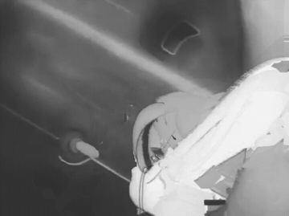
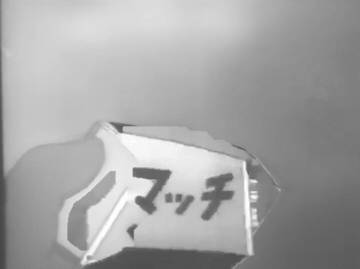
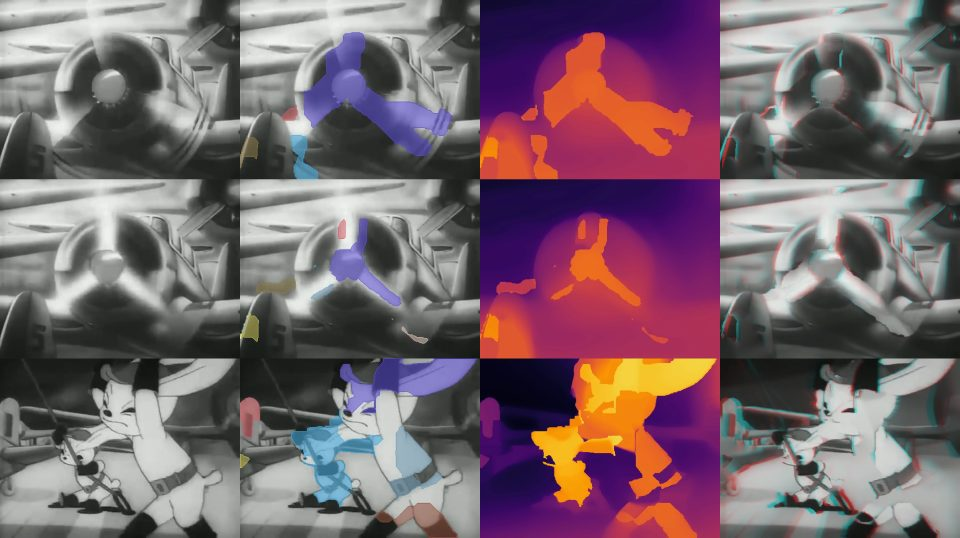
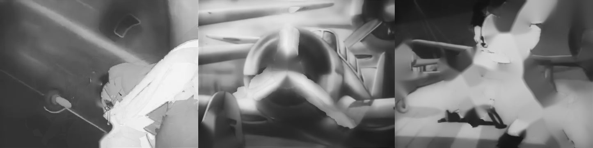
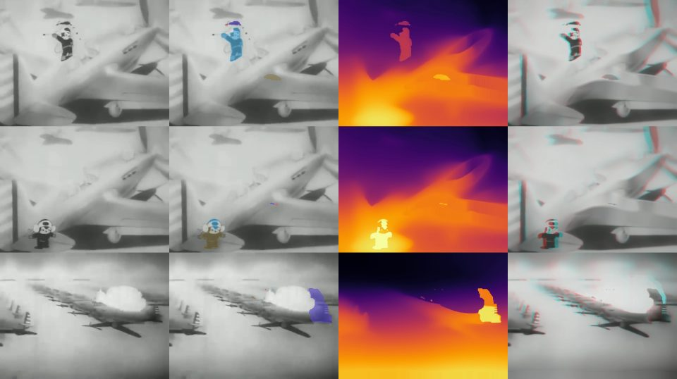
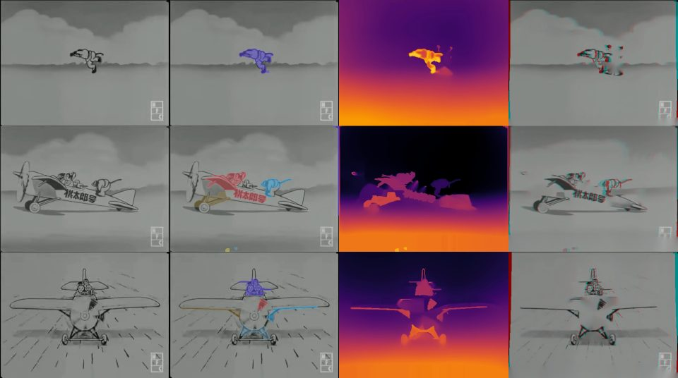

# anime2stereo

Lift traditional 2D cel animation into stereoscopic 3D (side-by-side for VR / 3D TVs,
red-cyan anaglyph, or wiggle GIFs) with classical computer vision plus one small
monocular depth network.

The core idea exploits how cel animation is physically made: a **static painted
background** (the camera only pans over it) with **moving cels** composited on top.
That structure makes the hardest part of 2D-to-3D conversion, filling in what is hidden
behind foreground objects (*disocclusion*), mostly solvable by looking at other frames
of the same shot instead of hallucinating pixels.

<p align="center">
  
  
</p>

Test footage: *Momotarō no Umiwashi* (1943) and *Sora no Momotarō* (1931), both
public-domain Japanese cel animation from the Internet Archive.

## Pipeline

```
video ─► deflicker ─► shot detection ─► per shot:
   ├─ pan estimation      block-median phase correlation, anchor re-registration
   ├─ clean plate         pan-aligned temporal median  (= temporal inpainting)
   ├─ cel segmentation    |frame − plate| residual → morphology → GrabCut edge snap
   ├─ 2nd-pass plate      median over background-labelled samples only
   ├─ depth               cel (ordinal) | ml (Depth-Anything-V2) | hybrid (default)
   │    └─ static layers  depth islands in the plate → image inpainting → re-segment
   └─ layered DIBR        z-buffered forward warp: complete plate + cels, per eye
 ─► SBS / anaglyph / wiggle / depth / debug montage + metrics.json
```

Each stage in a little more detail:

**Deflicker.** 1930s–40s film scans flicker in brightness; per-frame luminance mean/std
are matched to the shot median so temporal medians and residual thresholds behave.

**Pan estimation** (`stabilize.py`). Whole-frame phase correlation is hijacked by a
large, high-contrast moving character, so the frame is split into a grid of blocks, each
block is phase-correlated, and the response-weighted median block shift is taken: the
background occupies most blocks, the cels only a few. Pair-wise shifts are then
re-registered against an anchor frame and snapped to the photometrically best integer
offset so sub-pixel errors never accumulate over a long pan. (Two OpenCV gotchas handled
here: `phaseCorrelate` mutates its inputs in place, and its sub-pixel peak is biased by
0.5 px on odd or non-DFT-optimal sizes.)

**Clean plate** (`cleanplate.py`). Frames are placed on a canvas at their pan offsets and
a masked per-pixel temporal median is computed in row chunks. Every pixel that was
uncovered at *some* point in the shot is recovered exactly; never-covered canvas area is
Telea-inpainted. A second pass recomputes the median using only samples that pass one
labelled as background, which removes characters that occluded a pixel for more than half
the shot.

**Cel segmentation** (`segmentation.py`). The residual between a frame and its aligned
plate crop is thresholded, opened (film grain), closed (limbs), hole-filled, filtered by
area and majority-voted over a 3-frame window. GrabCut, initialised from the eroded /
dilated mask and run only inside the mask's bounding box, snaps the boundary to the drawn
contour line.

**Depth** (`depth.py`).
* `cel` – no ML. Background gets a ground-plane gradient; each cel is a flat card whose
  depth is ordered by its lowest point on screen (the multiplane camera heuristic).
* `ml` – Depth-Anything-V2-Small per frame, normalised with shot-wide percentiles.
* `hybrid` (default) – ML depth is run **once on the clean plate**, so the background is
  perfectly stable in time. Per-frame ML depth is affine-aligned to the plate's scale on
  background pixels (monocular depth is only defined up to scale/shift per image), and
  each cel gets the median of its ML depth, pushed at least `min_pop` in front of the
  background it occludes, plus `--cel-relief` × its internal ML variation. Cel depths are
  tracked across frames by overlap and smoothed with an EMA.
* **Static layers.** A character that never moves during a shot survives the temporal
  median and would be baked into the plate. The plate's own depth map exposes it as a
  near "island" relative to a large-kernel grey-scale opening; the plate colour and depth
  behind it are image-inpainted and the shot is re-segmented against the inpainted
  plate, so the character becomes an ordinary cel layer.

**Stereo rendering** (`stereo.py`). Depth-image-based rendering with a vectorised
z-buffered forward warp (`np.maximum.at` resolves collisions by nearness; extra splats
close 1 px cracks). Per eye: warp the *complete* plate with its depth, fill residual
cracks from the nearer horizontal neighbour, then warp all cels in one z-buffered pass
and alpha-composite with a soft contour. Because the plate already contains the
background behind every cel, the disocclusion holes that plague single-layer DIBR do not
occur; `metrics.json` reports the hole fraction a naive single-layer warp would have
produced versus what the layered render leaves (cracks only).

## Results

Run on a 10 s clip of *Momotarō no Umiwashi* (482×360, 240 frames, 4 shots) on an
Apple M4 (CPU + MPS):

RESULTS_TABLE

Strip = original | cel instances | depth (warm = near) | red-cyan anaglyph:



Clean plates for the same clip (temporal median, then static-layer inpainting). The
spinning propeller in shot 1 never uncovers the hub, so its ghost survives; the characters
in shots 2 and 3 were lifted out and inpainted behind:



More scenes (running character with sparks, a 1931 take-off shot):




## Install

```bash
pip install -e ".[ml]"      # torch + transformers for Depth-Anything (hybrid / ml modes)
pip install -e .            # classical-only; use --depth cel
```

Requires `ffmpeg` on PATH for mp4/GIF output (falls back to OpenCV's mp4v writer).
Depth-Anything-V2-Small (~100 MB) is downloaded from the Hugging Face hub on first use.

## Usage

```bash
anime2stereo input.mp4 -o out/ --start 270 --duration 10            # hybrid depth (default)
anime2stereo input.mp4 -o out/ --depth cel                            # no ML at all
anime2stereo input.mp4 -o out/ --max-disparity 0.02 --convergence 0.6 # milder, screen plane at depth 0.6
anime2stereo input.mp4 -o out/ --formats sbs-full,anaglyph --cel-relief 0.0
```

Outputs in `out/`: `stereo_sbs_half.mp4` (half-width side-by-side, plays in VR players
and 3D TVs in "SBS" mode), `stereo_anaglyph.mp4`, `wiggle.gif`, `depth.mp4`,
`debug_montage.mp4` (original / cels / depth / anaglyph), one `plate_shotNN.png` per
shot, and `metrics.json`.

Key flags: `--depth {cel,ml,hybrid}`, `--refine {none,grabcut}`, `--cel-threshold`,
`--cel-relief`, `--no-static-layers`, `--max-disparity` (fraction of width),
`--convergence` (zero-parallax depth, default = 75th percentile so most of the scene sits
behind the screen), `--device {cuda,mps,cpu}`.

Python API:

```python
from anime2stereo.pipeline import Config, process_video
process_video("clip.mp4", "out", Config(depth_mode="hybrid", cel_relief=0.3), start=270, duration=10)
```

## Tests

```bash
pytest
```

The tests build a synthetic cel animation (textured background, 1.5 px/frame pan, a
moving cel) and check pan estimation, exact plate recovery (PSNR > 30 dB), mask IoU,
second-pass plate improvement, stereo disparity direction/magnitude, zero disocclusion
holes in the layered render, cel depth ordering and shot detection.

## Limitations / next steps

* Backgrounds are assumed to move by pure translation. Zooms ("trucks") and multiplane
  parallax inside the background break the single-plate assumption; the shot falls back
  to ML depth without temporal inpainting.
* Static-layer detection needs the character to be a depth island; a character leaning
  on a same-depth prop (the rabbit on the wheel in shot 3) is kept in the plate and gets
  ML relief but no inpainting behind it.
* Image inpainting behind static characters is OpenCV Telea; a learned inpainter
  (LaMa) would give sharper fills for large regions.
* No sub-pixel plate placement; a very slow pan slightly softens the plate.
* Segmentation is motion-based; semantic/promptable segmentation (SAM) would help with
  cels that move with the background (e.g. a character on a moving vehicle).

## License

MIT. Test footage is public domain (Internet Archive items `momotaro-no-umiwashi-1943`,
`sora-no-momotaro-1931`); it is not included in the repository.
